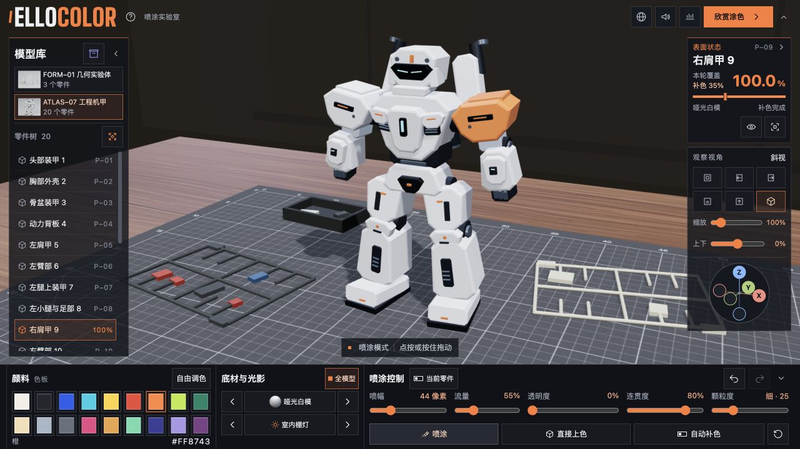

# ElloColor

ElloColor 是一个在浏览器里给三维模型喷漆的工具，适合试配色、比较底材和练习分件上色。你可以从示例模型开始，也可以导入自己的白模。

- 调节喷幅、流量、透明度和颗粒度，叠加漆层，也可直接上色、撤销和重做。
- 按全模型或单个零件上色，切换底材、灯光和观赏场景，用爆炸视图查看零件。
- 导入 GLB、FBX 或 STL 白模。作品保存在当前浏览器，可导出整个模型库，再合并到另一套工作台。

下载或克隆仓库后，保留完整目录，用支持 WebGL 2 的现代浏览器打开 [`index.html`](index.html)。点左侧资产库入口可选择示例、导入白模或迁移作品。浏览器若限制本地文件的存储，可通过静态服务器打开同一目录。

## 开发

源码在 `src/`。修改后用 Node.js 和 esbuild 重新打包。`node tools/build-models.mjs` 可重新生成示例，`node tools/build-web.mjs` 会更新浏览器脚本和离线资源。也可把 esbuild 可执行文件的路径传给 `build-web.mjs`。

## 许可

项目代码与自制示例按 [MIT](LICENSE) 发布。ElloColor 标识的使用及第三方依赖的许可见 [授权说明](THIRD_PARTY_NOTICES.md)。
