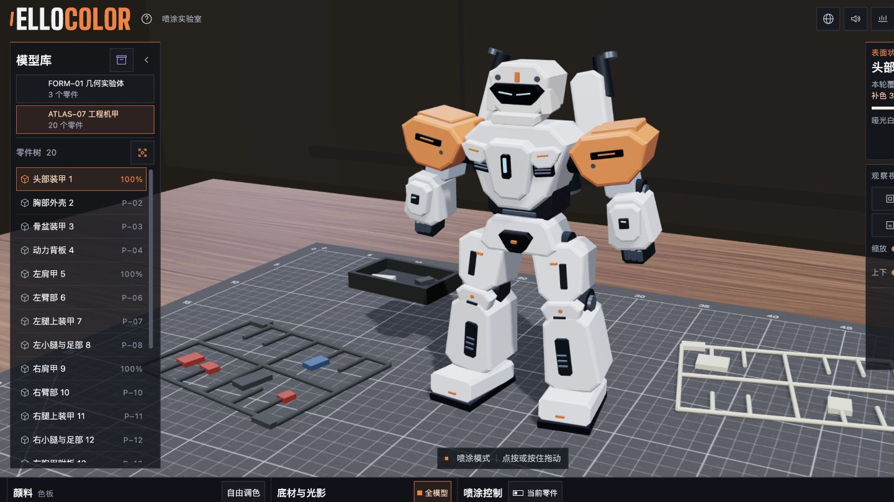
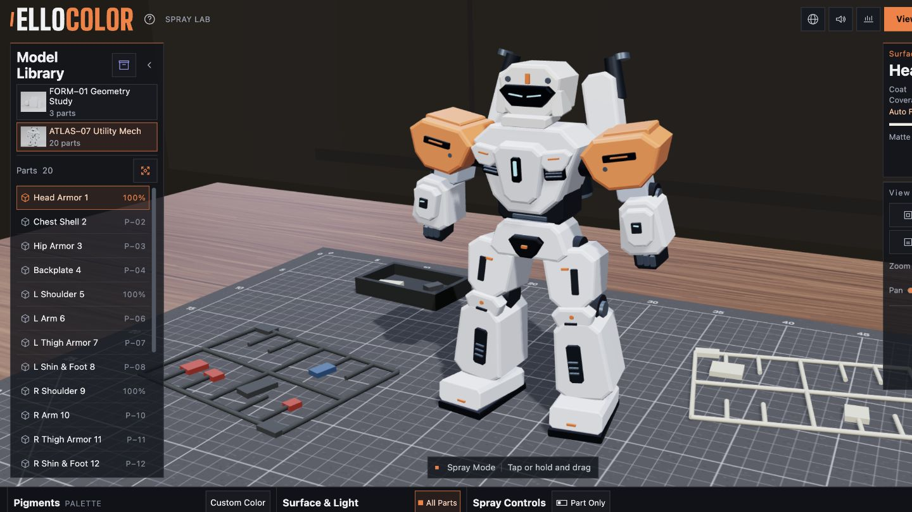

# ElloColor

[简体中文](#简体中文) · [English](#english)

**[在线体验 · 中文](https://leoushi.github.io/ElloColor/?lang=zh) · [Live demo · English](https://leoushi.github.io/ElloColor/?lang=en)**

## 简体中文

ElloColor 是一个在浏览器里给三维模型喷漆的工具，适合试配色、比较底材和练习分件上色。你可以从示例模型开始，也可以导入自己的白模。

- 调节喷幅、流量、透明度和颗粒度，叠加漆层，也可直接上色、撤销和重做。
- 按全模型或单个零件上色，切换底材、灯光和观赏场景，用爆炸视图查看零件。
- 导入 GLB、FBX 或 STL 白模。作品保存在当前浏览器，可导出整个模型库，再合并到另一套工作台。

下载或克隆仓库后，保留完整目录，用支持 WebGL 2 的现代浏览器打开 [`index.html`](index.html)。点左侧资产库入口可选择示例、导入白模或迁移作品。浏览器若限制本地文件的存储，可通过静态服务器打开同一目录。

## English

ElloColor is a browser-based 3D spray painting studio for trying color combinations, comparing surface materials, and painting individual parts. Start with a sample model or import your own unpainted model.

- Adjust spray width, flow, transparency, and grain. Layer coats, apply solid colors, and undo or redo strokes.
- Paint the entire model or individual parts. Switch materials, lighting, and viewing scenes, or inspect parts in an exploded view.
- Import unpainted GLB, FBX, or STL models. Work is saved in the current browser, and model library backups can be exported and merged into another workspace.

Download or clone the repository, keep the directory intact, and open [`index.html`](index.html) in a modern WebGL 2 browser. Open the asset library on the left to choose a sample, import a model, or transfer your work. If the browser restricts storage for local files, serve the same directory with a static web server.

## 开发 / Development

源码在 `src/`。修改后用 Node.js 和 esbuild 重新打包。`node tools/build-models.mjs` 可重新生成示例，`node tools/build-web.mjs` 会更新浏览器脚本和离线资源。也可把 esbuild 可执行文件的路径传给 `build-web.mjs`。

Source code is in `src/`. Rebuild with Node.js and esbuild. Run `node tools/build-models.mjs` to regenerate the sample models and `node tools/build-web.mjs` to rebuild the browser scripts and offline assets. You can pass the path to an esbuild executable to `build-web.mjs`.

## 许可 / License

项目代码与自制示例按 [MIT](LICENSE) 发布。ElloColor 标识的使用及第三方依赖的许可见 [授权说明](THIRD_PARTY_NOTICES.md)。

The project code and original sample assets are available under the [MIT License](LICENSE). See the [license notices](THIRD_PARTY_NOTICES.md) for the ElloColor mark and third-party dependencies.

## 作者 / Author

**Leou Shi**  
ElloWorld Digital  (Fonder)

**ElloMeta XR Studio**  
[www.ellometa.com](http://www.ellometa.com)

Wechat ID：shileou
